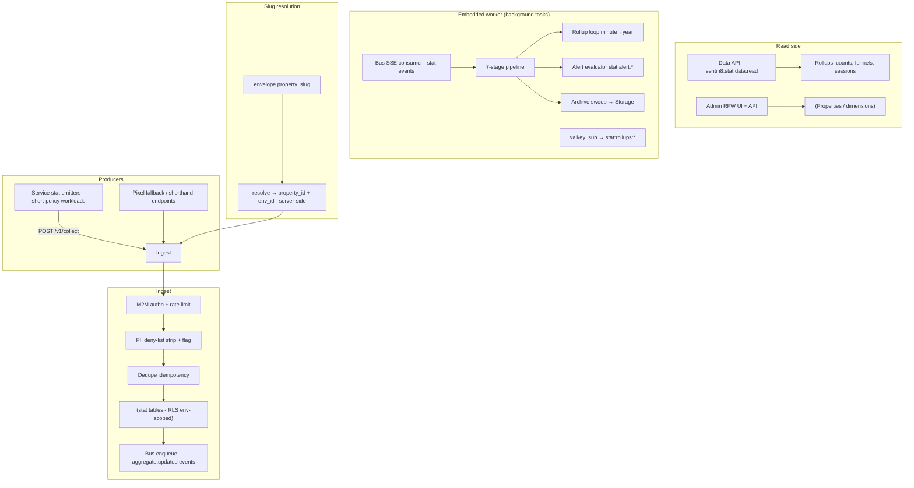

# Design Doc: Sentin8:Stat - Metrics & Analytics Service

## 1. Summary

Sentin8:Stat is the platform's metrics and analytics service. Producers
push metric envelopes (counters, gauges, timings, conversions, funnels)
via an M2M-authenticated ingest surface with slug-based property
resolution, rate limiting, PII stripping, and dedupe; a read-side data
API serves rollups and session/funnel analysis; an embedded worker
pipeline consumes the ingested events, computes the aggregate and
rollup hierarchy, evaluates curated alerts, and emits pipeline/alert
events back onto the Bus for dashboard consumers.

## 2. Motivation

- **One metrics plane.** Services, verticals, and apps all emit to the
  same property/slug vocabulary - spend, traffic, conversions, and AI
  token usage are comparable across the platform.
- **M2M-only ingest.** Measurement ingestion is machine traffic
  (service workloads claiming `sentin8:stat:measure` at DCR); user
  roles never gain ingest - the user/M2M boundary stays clean.
- **PII never enters analytics.** The ingest deny-list strips
  credential-ish keys from any persisted payload (email, pan, pin,
  token…) and flags stripped traces - metrics are aggregates, not
  personal data.
- **Cheap fire-and-forget.** Producers must never block on analytics;
  a Stat outage costs dashboards, not the business path.
- **One process for ingest + aggregation.** The worker pipeline (7-stage
  transform, rollups, alerts, archive) runs as background tasks inside
  the same service - one identity, one deployment unit, no separate
  worker binary or fleet to supervise.

## 3. Architecture & High-Level Design

- **Ingest** - collect endpoint accepting a single envelope or a
  batch; pixel fallback for browser beacons; shorthand endpoints for
  common counters; every path authenticates M2M, rate-limits per
  workload, strips PII, and dedupes on the envelope's idempotency key.
- **Slug resolution** - the envelope may carry `property_slug`
  instead of an id; Stat resolves it server-side (the shared client
  never pools property ids).
- **Embedded worker pipeline** - a Bus SSE consumer (group `stat`)
  runs the 7-stage pipeline (clean → attribute → stitch → enrich →
  aggregate → emit), the multi-granularity rollup loop (minute → year;
  each updated day-bucket emits `sentin8:stat:aggregate:updated` on
  the `stat-pipeline` family for downstream listeners),
  curated threshold alerts (`stat:stat:alert:event_spike` /
  `sentin8:stat:alert:conversion_drop` on the `stat-pipeline` family),
  the hourly archive sweep to Storage, and the Valkey pub/sub subscriber
  that republishes `stat:metrics:{tls,log}` as
  `stat:rollups:{minute,hour,day}` for Dash/BFF/Captain consumers.
- **Shield** - the admin surface is gated by the enforced scope-mirror
  set; decisions evaluate authenticated callers only.

## 4. Key Traits and Data Structures

- **`EventEnvelope`** - the ingest contract: property slug/id, metric
  name (e.g. `ai.token.input`, `stat:metrics:tls` traffic counters),
  value, dimensions (env/feature/model), timestamp, idempotency key.
- **`CollectBody`** - single envelope or batch (untagged serde).
- **Property / dimension records** - the metric vocabulary: slug,
  name, allowed dimensions; the admin API manages them
  (`sentin8:stat:admin` scope).
- **Aggregate tables** - precomputed rollups (counts, funnels,
  sessions) the data API queries.
- **PII deny-list** - mirrors the AI safety filter's keys; stripping
  is top-level key removal with a flagged result.

## 5. Rationale, Trade-offs, and Alternatives

- **Slug-based ingest over id pools.** The shared Stat client reports
  against a property slug (`ai`, per-service slugs); Stat resolves it
  server-side. A client-side id pool would need seeding per env and
  drift the moment a property is recreated.
- **M2M-only ingest with rate limits.** Ingest is machine traffic;
  per-workload rate limits contain a runaway emitter without
  punishing others. User-facing ingest (pixel/shorthand) is
  rate-limited per client IP with bot-protection semantics.
- **PII deny-list at ingest.** Payload keys matching the deny-list
  (`email`, `pan`, `pin`, `ssn`, `token`…) are stripped before
  persistence - mirrors the AI safety filter so both planes share one
  vocabulary. Metrics that need identities belong in domain tables,
  not analytics.
- **Idempotency-key dedupe.** At-least-once producers (Bus relays,
  retries) would double-count without it; the envelope's key makes
  replays idempotent within the window.
- **Aggregates precomputed.** Dashboards query rollups, not raw
  events; ad-hoc scans of the event table would grow unbounded.
  Aggregates are emitted on the Bus so consumers react to updates
  (push, not poll).
- **Embedded worker over a separate worker service.** Aggregation
  (pipeline + rollups + alerts) is CPU-bound but bursty; background
  tasks inside the same process remove the second binary, catalog
  entry, M2M workload, and health port without changing any
  interaction pattern - the ingest path still returns after
  persistence, and the pipeline runs behind it.
- **Fire-and-forget ingestion path.** A Stat outage never blocks
  inference/business calls (the trace row already carries the spend);
  emission retries are best-effort.
- **Funnel/session primitives.** Conversion analysis (signup →
  install → activation) is a platform-level need (App Store, AI
  evaluations); first-class funnel tables keep those queries indexed
  and bounded.
- **Rejected: per-vertical metrics stores.** Cross-vertical comparison
  (cost per model, traffic per service) is the point; one vocabulary
  + one query API beats N silos.
- **Rejected: client-side aggregation only.** Client-side rollups lose
  the raw events needed for re-aggregation and audits; Stat stores
  events then rolls up server-side.

## 6. Internal Implementation & Invariants (Private Design)

- **Invariants:**
  - Ingest requires a verified M2M token claiming `sentin8:stat:measure`
    (user roles never receive it); the pixel/shorthand paths
    rate-limit per IP.
  - Every ingest dedupes on the envelope's idempotency key within the
    window; duplicate envelopes return the original acceptance.
  - PII deny-list stripping runs before any persistence; stripped
    payloads are flagged so dashboards can distinguish.
  - RLS is enforced at the database level; the store sets the tenant
    context via `sentin8_set_tenant_context` before reads/writes -
    same connection, same transaction.
  - Slug resolution happens server-side; the ingest never trusts a
    caller-provided `property_id` when a slug is present.
  - Audit events for Admin API calls ride the shared outbox.
  - Shield evaluates authenticated callers only (unauthenticated
    requests are rejected before policy).
- **Boot (shell-owned).** The shell owns the listener stack; Stat
  builds its capped pool, consumes the Shield engine, spawns the
  worker pipeline tasks (Bus SSE consumer, DB fallback poll, rollup
  loop, alert evaluator, Valkey subscriber, hourly archive sweep), and
  mounts ingest + data API + admin surfaces.
- **Store.** Events are written with bounded partitioning; aggregates
  are recomputed incrementally per ingest (no full-table re-scan per
  envelope).

## 7. Unresolved Questions / Future Designs

- Time-series downsampling is already the worker contract (the `rollups` table
  holds hour→year; the archive holds raw).
- Per-workload ingest quotas extend the token-bucket key to `(env_id,
  workload)` and surface depth in the admin UI.
- OpenTelemetry-compatible export defers to the middleware crate's OTel seam
  (the platform-level answer).
- Alert rules are resolved: per-property custom rules live in `stat.alert_rules`
  (admin CRUD under `/v1/admin/properties/{id}/alert-rules`) with two rule
  types - `threshold` (metric value vs comparator/threshold) and `anomaly`
  (moving-average deviation factor over the past `window_hours` of daily
  buckets) - evaluated each 60s pass by the embedded worker and fired onto the
  existing alert → Post path (`sentin8:stat:alert:rule_triggered`, same
  envelope as the curated rules plus `rule_id`/`rule_type`); the curated
  spike/drop rules remain as the platform-telemetry plane.
- Rule edit/update (PUT) is a future refinement - today rules are created,
  listed, and deleted (disable via a new rule or delete + recreate).

---

**Architecture & Design:** sentin8:stat and its underlying concepts were designed by [Hamid Jahanzad](https://www.linkedin.com/in/hamidjahanzad/).
